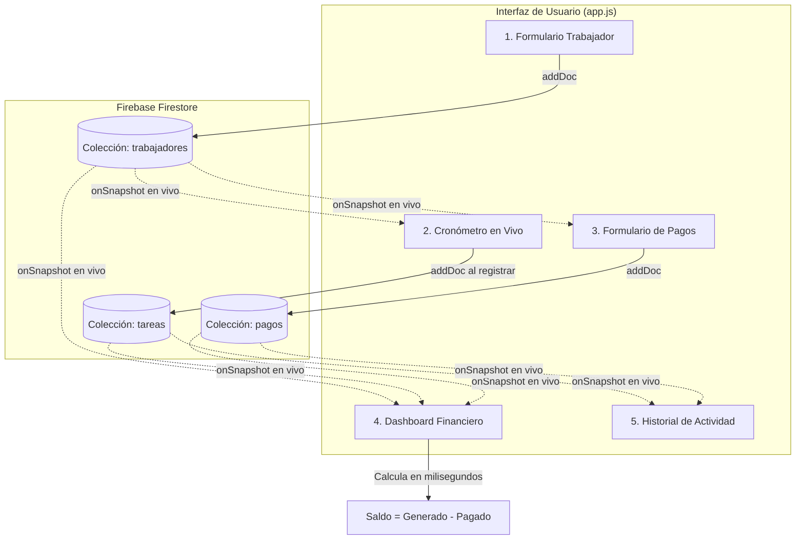

# 📖 Manual de Funcionamiento y Arquitectura del Proyecto
## **Widely Tracker & Financial Dashboard**

Este documento detalla a fondo la arquitectura, el modelo de datos, la lógica de negocio, los cálculos matemáticos y el flujo operativo de la aplicación web **Widely Tracker**.

---

## 📑 Tabla de Contenidos
1. [Visión General del Proyecto](#1-visión-general-del-proyecto)
2. [Arquitectura del Sistema y Stack Tecnológico](#2-arquitectura-del-sistema-y-stack-tecnológico)
3. [Diagrama de Flujo de Datos (Arquitectura en Tiempo Real)](#3-diagrama-de-flujo-de-datos)
4. [Módulos y Funcionamiento Paso a Paso](#4-módulos-y-funcionamiento-paso-a-paso)
   - [Módulo A: Gestión de Trabajadores](#módulo-a-gestión-de-trabajadores)
   - [Módulo B: Tracker de Tareas (Cronómetro en Vivo)](#módulo-b-tracker-de-tareas-cronómetro-en-vivo)
   - [Módulo C: Registro de Pagos y Adelantos](#módulo-c-registro-de-pagos-y-adelantos)
   - [Módulo D: Dashboard Financiero Dinámico](#módulo-d-dashboard-financiero-dinámico)
   - [Módulo E: Historial y Auditoría de Registros](#módulo-e-historial-y-auditoría-de-registros)
   - [Módulo F: Sistema de Temas y Tipografía Anybody](#módulo-f-sistema-de-temas-y-tipografía-anybody)
   - [Módulo G: Adaptabilidad Universal Multi-Dispositivo](#módulo-g-adaptabilidad-universal-multi-dispositivo)
   - [Módulo H: Sistema de Autenticación, Roles y Perfiles de Trabajador](#módulo-h-sistema-de-autenticación-roles-y-perfiles-de-trabajador)
5. [Fórmulas y Lógica de Negocio](#5-fórmulas-y-lógica-de-negocio)
6. [Modelo de Datos en Firebase Firestore](#6-modelo-de-datos-en-firebase-firestore)
7. [Guía de Inicialización, Ejecución y Despliegue](#7-guía-de-inicialización-ejecución-y-despliegue)

---

## 1. Visión General del Proyecto

**Widely Tracker** es una solución integral diseñada para resolver un problema crítico en agencias, consultoras y equipos de trabajo: **el control preciso del tiempo facturable y la conciliación financiera inmediata entre dinero generado y dinero pagado**.

A diferencia de las hojas de cálculo tradicionales o herramientas dispersas, Widely Tracker unifica:
1. **Medición del tiempo en vivo** con cálculo monetario instantáneo.
2. **Base de datos reactiva en la nube** (Firestore), permitiendo que múltiples usuarios o administradores vean las actualizaciones sin recargar la página.
3. **Dashboard de balance en tiempo real**, alertando deudas pendientes por liquidar o anticipos a favor.
4. **Diseño de alta gama**, con soporte nativo de Modo Claro y Oscuro y la tipografía neo-grotesca **Anybody**.

---

## 2. Arquitectura del Sistema y Stack Tecnológico

```
┌─────────────────────────────────────────────────────────────┐
│                       CLIENTE (Browser)                     │
│  ┌───────────────────────┐       ┌───────────────────────┐  │
│  │      index.html       │       │       styles.css      │  │
│  │ (Tailwind + Anybody)  │       │ (Theme, Cards, Aura)  │  │
│  └───────────┬───────────┘       └───────────┬───────────┘  │
│              │                               │              │
│              └───────────────┬───────────────┘              │
│                              ▼                              │
│                         app.js                              │
│           (Lógica del Cronómetro, Estado Local,             │
│            Cálculos Financieros & Reactividad)              │
└──────────────────────────────┬──────────────────────────────┘
                               │
               ┌───────────────┴───────────────┐
               ▼                               ▼
  ┌────────────────────────┐      ┌────────────────────────┐
  │   Firebase Firestore   │      │   Backend Python       │
  │   (Base de Datos NoSQL │      │   (FastAPI + Uvicorn)   │
  │    en Tiempo Real SDK) │      │   Servidor Local / API  │
  └────────────────────────┘      └────────────────────────┘
```

### Tecnologías:
- **Frontend Core:** HTML5 semántico, JavaScript Vanilla moderno (ES Modules).
- **Tipografía:** Variable Font **Anybody** (Tyler Finck / Google Fonts), con soporte numérico tabular (`tnum`).
- **Diseño & Estilos:** Tailwind CSS (CDN) + Hoja de estilos personalizada `styles.css` con variables CSS adaptativas para Dark/Light mode.
- **Base de Datos:** Google Firebase Firestore SDK v10 (modular ESM), con sincronización reactiva bidireccional (`onSnapshot`).
- **Backend Opcional:** Python 3.13 con **FastAPI** y **Uvicorn** para servir archivos estáticos, diagnóstico (`/api/health`) y extensibilidad.
- **Despliegue & Git:** GitHub Pages para hosting estático mundial gratuito con HTTPS y repositorio en GitHub.

---

## 3. Diagrama de Flujo de Datos



---

## 4. Módulos y Funcionamiento Paso a Paso

### Módulo A: Gestión de Trabajadores
- **Propósito:** Registrar al personal y su costo de hora laboral.
- **Inputs:** Nombre Completo (requerido) y Tarifa por Hora ($ USD, opcional con valor por defecto `$0.00`).
- **Flujo:**
  1. Al presionar **"Guardar Trabajador"**, se valida que el nombre no esté vacío. Si el campo de tarifa se deja en blanco, se asigna automáticamente como `$0.00/h` (sin tarifa fijada).
  2. Se envía el documento a la colección `trabajadores` en Firestore.
  3. **Asignación / Edición de Tarifa en el Menú:**
     - En la lista de trabajadores activos, cada registro cuenta con un botón interactivo **`[ Asignar Tarifa ]`** o **`[ Editar ]`**.
     - Al hacer clic (o al pulsar sobre la celda de tarifa en el Dashboard), se despliega un modal centrado que permite configurar o modificar la tarifa por hora en tiempo real mediante `updateDoc()`.
  4. El listener `onSnapshot` detecta cualquier cambio y actualiza en milisegundos:
     - El menú desplegable del cronómetro.
     - El menú desplegable del registro de pagos.
     - La lista de trabajadores activos.
     - Los balances y costos del Dashboard Financiero.

---

### Módulo B: Tracker de Tareas (Cronómetro en Vivo)
- **Propósito:** Medir la duración de una sesión de trabajo y calcular su costo monetario en tiempo real.
- **Precisión Temporal:**
  - En lugar de confiar únicamente en `setInterval(..., 1000)` (que sufre desfases si el navegador entra en segundo plano), el cronómetro almacena la marca de tiempo absoluta:
    $$\text{startTime} = \text{Date.now}() - (\text{elapsedSeconds} \times 1000)$$
  - Cada segundo calcula:
    $$\text{elapsedSeconds} = \lfloor (\text{Date.now}() - \text{startTime}) / 1000 \rfloor$$
- **Cálculo en Vivo:**
  - Mientras el reloj avanza, calcula y muestra el costo parcial acumulado:
    $$\text{Costo en Vivo} = \left(\frac{\text{segundos}}{3600}\right) \times \text{Tarifa del Trabajador Seleccionado}$$
- **Controles:**
  - **Iniciar:** Activa el temporizador, enciende el aura pulsante (`.timer-glow-pulse`) y deshabilita el botón Iniciar.
  - **Pausar:** Detiene la cuenta, conserva los segundos transcurridos y apaga el pulso.
  - **Reiniciar:** Restablece a `00:00:00` y limpia el costo acumulado.
  - **Registrar Tarea y Guardar Costo:**
    - Valida que haya transcurrido al menos 1 segundo y que un trabajador esté seleccionado.
    - Calcula el costo final redondeado a 2 decimales.
    - Guarda en la colección `tareas` de Firestore con la fecha actual (ISO) y marca de tiempo (`serverTimestamp()`).
    - Reinicia el cronómetro automáticamente y emite una notificación toast de confirmación.

---

### Módulo C: Registro de Pagos y Adelantos
- **Propósito:** Asentar anticipos, quincenas o liquidaciones abonadas a un trabajador.
- **Inputs:** Selector de Trabajador, Monto ($), Fecha y Concepto/Referencia (ej. "Transferencia #4082").
- **Flujo:**
  1. Valida monto $> 0$ y trabajador existente.
  2. Guarda el documento en la colección `pagos` de Firestore.
  3. Al confirmarse en Firestore, el Dashboard Financiero reduce instantáneamente el Saldo Pendiente del trabajador correspondiente.

---

### Módulo D: Dashboard Financiero Dinámico
- **Propósito:** Conciliar en una sola vista el estado contable de cada colaborador y de la empresa en general.
- **Columnas por Trabajador:**
  1. **Trabajador:** Avatar con inicial y nombre completo.
  2. **Tarifa/h:** Costo por hora acordado.
  3. **Horas:** Total acumulado en formato decimal (ej. `12.50h`) y en horas/minutos/segundos (ej. `12:30:00`).
  4. **Generado ($):** Suma total de los costos de todas las tareas registradas por ese trabajador.
  5. **Pagado ($):** Suma total de todos los pagos registrados hacia ese trabajador.
  6. **Saldo Pendiente ($):** Diferencia exacta calculada:
     $$\text{Saldo Pendiente} = \text{Generado} - \text{Pagado}$$
- **Lógica de Formato Condicional (Badges):**
  - **Saldo $> 0$ (Se le debe dinero):** Badge en **Rojo brillante con animación de pulso** (`+$XX.XX` Deuda por liquidar).
  - **Saldo $= 0$ (Al día):** Badge en **Verde esmeralda** (`$0.00` Al día).
  - **Saldo $< 0$ (Anticipo pagado):** Badge en **Azul suave** (`-$XX.XX` Saldo a favor de la empresa).
- **Tarjetas Superiores (KPIs):**
  - Muestran las sumatorias globales consolidadas de todo el equipo en tiempo real.

---

### Módulo E: Historial y Auditoría de Registros
- **Propósito:** Permitir al administrador revisar cada tarea individual y cada pago registrado.
- **Pestañas:** Conmutador segmentado para ver *"Tareas Registradas"* o *"Historial de Pagos"*.
- **Eliminación Segura con Modal:**
  - Al hacer clic en el cesto de basura de cualquier tarea, pago o trabajador, se abre un modal de confirmación centrado con desenfoque de fondo.
  - Si se confirma, se llama a `deleteDoc()` en Firestore.
  - Al borrarse el registro en la nube, el Dashboard Financiero recalcula automáticamente los saldos sin requerir F5.

---

### Módulo F: Sistema de Temas y Tipografía Anybody
- **Modo Claro & Oscuro Instantáneo:**
  - El archivo `index.html` incluye un script inmediato en el `<head>` que lee `localStorage.getItem('widely_theme')` o la preferencia del sistema operativo antes de pintar la pantalla, evitando parpadeos de luz (FOUC).
  - El botón superior con icono y texto (**"Modo Claro" / "Modo Oscuro"**) conmuta la clase `.dark` en el elemento `<html>` y actualiza `localStorage`.
- **Tipografía Variable Anybody:**
  - Aplicada globalmente para conferir una estética técnica, audaz y de vanguardia.
  - Las tablas, métricas y el cronómetro usan números tabulares (`font-feature-settings: 'tnum'; font-variant-numeric: tabular-nums`), asegurando que todos los dígitos tengan idéntico ancho geométrico y no bailen en pantalla al cambiar los segundos.

---

### Módulo G: Adaptabilidad Universal Multi-Dispositivo
- **Smartphones y Celulares (320px - 480px):**
  - Viewport configurado con `viewport-fit=cover` y soporte de `env(safe-area-inset-*)` para notches y barras de navegación móviles.
  - Tarjetas de KPIs dispuestas en cuadrícula de 2 columnas (`grid-cols-2`) para evitar scroll vertical infinito.
  - Cronómetro digital con escalado fluido `clamp(2.2rem, 7.5vw, 3.75rem)` que previene cualquier desborde o salto de línea.
  - Prevención automática del zoom intrusivo de iOS Safari (`font-size: 16px` en inputs bajo 640px).
  - Tablas de balances con scroll táctil acelerado por hardware (`-webkit-overflow-scrolling: touch`) e indicador visual de desplazamiento.
- **Tablets y Plegables (600px - 1024px):**
  - Distribución adaptativa equilibrada con paneles táctiles amplios (tap targets $\ge 44\text{px}$).
- **Escritorio y Laptops (1024px - 1440px):**
  - Layout simétrico de 4 niveles con micro-interacciones sutiles (`:active:scale-95`).
- **Monitores Ultrawide, 4K y Smart TVs (1920px - 3840px):**
  - Contenedor con expansión ultra-ancha progresiva (`2xl:max-w-[1536px]`, `3xl:max-w-[1780px]`, `4k:max-w-[2200px]`).
  - Navegación accesible compatible con control remoto de Smart TV / teclado (`:focus-visible` con anillo azul nítido).

---

### Módulo H: Sistema de Autenticación, Roles y Perfiles de Trabajador
- **Propósito:** Permitir que cada trabajador cuente con un usuario y contraseña individuales, asegurando una experiencia distribuida, privada y estructurada para todo el equipo.
- **Roles Soportados:**
  1. **`admin` (Administrador):**
     - Control total sobre todas las funciones.
     - Visualización global del rendimiento y los balances acumulados de todos los colaboradores.
     - Acceso exclusivo a la **Sección 3: Paneles de Gestión**, permitiendo registrar nuevos trabajadores, modificar sus tarifas por hora y asentar pagos/anticipos.
     - Capacidad de auditar y eliminar registros en las tablas históricas.
  2. **`worker` (Colaborador / Trabajador):**
     - **Vista Personal Exclusiva:** Despliega una alerta superior identificando el *Modo Trabajador*.
     - **Cronómetro Pre-asignado y Bloqueado:** El menú selector del cronómetro se vincula automáticamente a su cuenta y se inhabilita para evitar que registre horas a nombre de otro colega.
     - **Métricas Personales (KPIs de Sección 1):** Muestra únicamente sus horas computadas, el dinero que ha acumulado, los pagos que le han transferido y su saldo pendiente exacto por cobrar.
     - **Historial Filtrado:** Solo visualiza sus propias tareas y pagos en la Sección 4.
     - **Restricción de Privacidad:** Los paneles de creación de trabajadores, asignación de tarifas y registro de pagos quedan totalmente ocultos.
- **Mecanismo de Respaldo Failsafe (Zero Lockout):**
  - Incluye dos accesos rápidos con un solo clic (**"Modo Administrador"** y **"Modo Trabajador"**). Si en Firebase Console aún no se ha activado el proveedor de correo y contraseña, el sistema redirige automáticamente al usuario para que nunca se quede bloqueado y pueda evaluar la experiencia inmediatamente.
  - La sesión activa se conserva en `localStorage` (`widely_cached_user`) para recordar el rol al recargar la página.

---

## 5. Fórmulas y Lógica de Negocio

### 1. Conversión de Segundos a Horas Decimales:
$$\text{Horas Decimales} = \frac{\text{segundos}}{3600}$$

### 2. Costo Total de una Tarea:
$$\text{Costo Tarea} = \text{round}\left(\text{Horas Decimales} \times \text{TarifaHora}, 2\right)$$

### 3. Total Generado por un Trabajador:
$$\text{Total Generado}_w = \sum_{t \in \text{Tareas}_w} \text{costoTotal}_t$$

### 4. Total Pagado a un Trabajador:
$$\text{Total Pagado}_w = \sum_{p \in \text{Pagos}_w} \text{monto}_p$$

### 5. Saldo Pendiente de un Trabajador:
$$\text{Saldo Pendiente}_w = \text{round}\left(\text{Total Generado}_w - \text{Total Pagado}_w, 2\right)$$

---

## 6. Modelo de Datos en Firebase Firestore

### Colección: `usuarios`
```json
{
  "uid": "firebaseAuthUid123",
  "nombre": "Johan Santana",
  "email": "johan@widely.com",
  "rol": "worker",
  "trabajadorId": "abc123DocId",
  "createdAt": "Timestamp"
}
```

### Colección: `trabajadores`
```json
{
  "nombre": "Camila González",
  "tarifaHora": 25.00,
  "createdAt": "Timestamp"
}
```

### Colección: `tareas`
```json
{
  "fecha": "2026-10-12",
  "trabajadorId": "abc123DocId",
  "trabajadorNombre": "Camila González",
  "descripcion": "Diseño UI y Prototipado",
  "segundos": 3600,
  "horas": 1.0,
  "tarifaHora": 25.00,
  "costoTotal": 25.00,
  "createdAt": "Timestamp"
}
```

### Colección: `pagos`
```json
{
  "fecha": "2026-10-12",
  "trabajadorId": "abc123DocId",
  "trabajadorNombre": "Camila González",
  "monto": 50.00,
  "referencia": "Transferencia Bancaria #1092",
  "createdAt": "Timestamp"
}
```

---

## 7. Guía de Inicialización, Ejecución y Despliegue

### Ejecución Local con Python (FastAPI):
1. Abrir terminal en la carpeta del proyecto:
   ```powershell
   cd "time-tracker"
   ```
2. Instalar dependencias:
   ```powershell
   pip install -r requirements.txt
   ```
3. Iniciar el servidor:
   ```powershell
   python main.py
   ```
4. Navegar a:
   👉 **`http://localhost:8000`** (App)
   👉 **`http://localhost:8000/docs`** (Swagger API Docs)

---

### Despliegue en la Nube (GitHub Pages):
Dado que la aplicación está arquitecturada con **Firebase Firestore Web SDK en el cliente**, no requiere de un servidor tradicional para funcionar en producción.

- **URL Pública Oficial:**
  👉 **[https://johana-engineer.github.io/widely-time-tracker/](https://johana-engineer.github.io/widely-time-tracker/)**

- **Seguridad y Gestión de Secretos (GitHub Secrets):**
  Para evitar que la clave de API quede expuesta en el repositorio público, la aplicación utiliza una arquitectura de resolución por capas:
  1. **En GitHub Pages (Producción):** El flujo automatizado de CI/CD `.github/workflows/deploy.yml` inyecta en tiempo de despliegue la clave guardada en los **GitHub Secrets** (`FIREBASE_API_KEY`) dentro de `env.js`.
  2. **En Local:** Se utiliza un archivo `env.js` (ignorado por `.gitignore`), con plantilla de ejemplo en `env.example.js`.
  3. **En Navegador (Fallback):** Permite el ingreso manual y almacenamiento local en `localStorage` si no se detecta ninguna clave.

- **Flujo de Publicación Automática:**
  Cualquier cambio confirmado en la rama `main` dispara automáticamente el workflow de GitHub Actions que inyecta los secretos y publica la versión en GitHub Pages:
  ```powershell
  git add .
  git commit -m "feat: nuevo ajuste o mejora"
  git push origin main
  ```

---

*Manual elaborado y verificado para Widely Tracker v2.0.*
